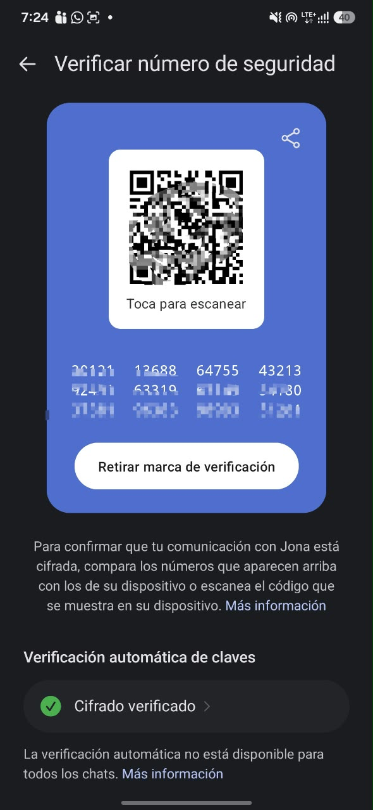

# SIGNAL.md — Safety Number y qué sabe el servidor

## Parte A — Safety Number

**Estado: hecho.** La conversación con Jona quedó **marcada como verificada** en Signal oficial (Android). Captura con los números de teléfono tachados: [evidence/safety-number-tachado.png](evidence/safety-number-tachado.png).

Lo que muestra la pantalla: el QR y los 60 dígitos del número de seguridad (parcialmente difuminados), el botón **"Retirar marca de verificación"**, que solo aparece cuando la conversación ya está verificada, y debajo **"Verificación automática de claves: Cifrado verificado"**. Signal aclara en esa misma pantalla que la verificación automática no está disponible para todos los chats.

Pasos seguidos:
1. Intercambiar 1 o 2 mensajes de prueba acordados ("hola Lab 18"). Nada sensible.
2. Abrir la conversación, tocar el nombre del contacto y entrar a **View safety number**.
3. Comparar en persona: escanear el QR del otro o leer los dígitos. Si coinciden, marcar **Verified**.
4. Captura de pantalla de la verificación, **tachando números de teléfono** (y no incluir nada más personal). Guardarla como `evidence/safety-number-tachado.png`.

**¿Qué ataque detectaría un Safety Number que no coincide?** Un ataque de intermediario (MITM) o una sustitución de keys. X3DH no puede probar por sí solo que la identity key del prekey bundle es realmente la del contacto: un servidor malicioso, o alguien que lo controle, podría entregar otra key. El Safety Number se deriva de las identity keys de ambos, así que si alguien se interpuso, el número que ve cada lado difiere. Si el contacto solo reinstaló Signal o cambió de teléfono, el número también cambia, pero Signal lo avisa y hay una explicación; lo anómalo es un cambio sin motivo.

## Parte B — Tabla servidor-sabe / servidor-no-lee

| Dato | ¿El servidor de Signal lo sabe o puede saberlo? | ¿Por qué? (diseño o fuente) |
|---|---|---|
| Texto del mensaje | **No** | E2EE: cada mensaje se cifra con una key del Double Ratchet que solo tienen los dispositivos de los extremos. El servidor transporta bytes cifrados. |
| Que su cuenta existe | **Sí** | La cuenta se registra con un número de teléfono y el servidor necesita saber qué cuentas existen para entregarles mensajes. Signal reporta que pudo entregar la fecha y hora de registro de una cuenta ([signal.org/bigbrother](https://signal.org/bigbrother/)). |
| Cuándo se conectó su dispositivo | **Sí** | El dispositivo se conecta al servicio para recibir mensajes. Signal reporta que pudo entregar la última fecha de conexión (bigbrother). |
| Tamaño aproximado del mensaje | **Sí, en tránsito** | El servidor transporta el mensaje cifrado y su tamaño es visible; es una inferencia de diseño de cualquier servicio de mensajería, no un dato que Signal reporte guardar. |
| Quién envió el mensaje | **Busca que no** | Con **sealed sender** el remitente va dentro del sobre cifrado y el servidor no sabe quién envió cada mensaje (sí sabe a qué cuenta se entrega). Fuente: [signal.org/blog/sealed-sender](https://signal.org/blog/sealed-sender/). |
| Su IP mientras está conectado | **Sí, en tránsito** | El servidor ve la IP desde la que se conecta el cliente mientras transmite. Signal no reporta haber entregado IPs en sus respuestas a órdenes judiciales, pero E2EE no esconde la IP de la conexión: eso es lo que resuelve Tor (S20). |
| Su lista de contactos / grupos | **No** | Signal declara que perfiles, grupos y contactos se cifran de extremo a extremo; en bigbrother dice no tener acceso a información de grupos ni a contactos. |

### Contraste con signal.org/bigbrother

Lo que el servidor **ve en tránsito** es más que lo que **guarda y puede entregar**. En tránsito ve que la cuenta existe, cuándo se conecta, la IP del cliente, el tamaño de lo que entrega y a qué cuenta va cada mensaje. Pero en las respuestas a órdenes judiciales que Signal publica, lo único que dice haber podido producir es la **fecha y hora de registro** de una cuenta y la **última fecha de conexión**. Diferencia práctica: que el servidor pueda ver un dato un instante no significa que lo conserve y lo pueda entregar después.

Aclaración de fuente: bigbrother es la declaración del propio proveedor, no una auditoría independiente.

## Línea para el chat de lab

`safety number verified: sí` · `el servidor no puede leer el texto de los mensajes pero sí sabe que la cuenta existe y cuándo se conectó`
